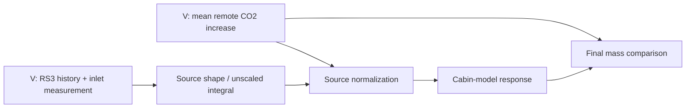

# IGNIS: competitive core decision

**7 November 2026 · Emberfall · Universal Event · one active builder**  
Research and solution assessment; no competition application implemented. This is a new recommendation, not a rewrite of [the previous report](IGNIS_Astra_Research_and_Winning_Solution.md), its evaluation protocols, or the original records.

**Decision: strengthen the product by replacing its central task.** Build a dashboard that constructs a source-backed **model-validation plan**: which investigation and observation can test a specified prediction, which measurements instead supply inputs or calibration, and what is still needed to execute the test. Retain source-linked revision and export as mechanisms. Keep the PMMA rod reconstruction as a control, rather than the main scientific payoff.

**New evidence obtained:** three original NASA-hosted Saffire papers, including methods and visually inspected source tables/figures, establish a consequential difference between two flight investigations. In Saffire V, a remote-sensor CO₂ increase helped normalize the model's source input; the resulting total-mass agreement is therefore conditioned on that observation. In Saffire VI, source inputs came from the flow-unit measurements, supporting a more separable test against remote cabin responses. The published VI results also show why close final mass agreement alone is insufficient to establish transient transport fidelity. This assessment reconstructs those dependencies and performs the numerical consistency checks below. [V methods, pp. 5–7](https://ntrs.nasa.gov/api/citations/20240008602/downloads/ICES-2024-310.pdf#page=5); [VI methods/results, pp. 4–12](https://ntrs.nasa.gov/api/citations/20250002675/downloads/Vehicle%20Modeling_FINAL.pdf#page=4).

**The contribution to pursue:** for a combustion researcher preparing a validation study, IGNIS turns a declared model boundary and reviewed experimental evidence into a ranked, revisable validation plan with observation roles, source dependencies, appropriate comparison quantities, and an acquisition checklist. Against an equally informed spreadsheet plus a strong research assistant, the proposed benefit is less work to produce and revise a correct plan. No superiority has been measured.

| Status | What this session establishes |
|---|---|
| **Established at case level** | A defensible choice of Saffire VI PMMA as the principal candidate for conditional cabin-transport testing, with V serving a different, explicitly conditioned role. The source-role reconstruction and arithmetic are assistant-checked. |
| **Plausible** | Software can make this recurring scientific operation easier and less error-prone. The event-sized implementation is feasible under the scope below. |
| **Blocked for stronger claims** | No synchronized raw series or runnable FDS case was acquired; no new physical model was validated. Independent review, actual users, and preparation-reuse permission remain absent. |
| **Rejected** | A catalogue or gap map as sufficient differentiation; a PMMA minimum as the central payoff; automatic extraction/linkage claims; predictive SOTA, habitat certification, or an award guarantee. |

## 1. The previous core's weakest assumption

The old design completes a legitimate job: reconstruct a published comparison, change its evidence scope, and export the revised result consistently. Its strength is making a calculation inspectable, not predictive ML. The first-logged-burn example remains a valid demonstration of a changed population; it does not overturn the all-burn result or identify a physical oxygen threshold.

The weak product assumption is that researchers need this particular revision frequently enough to adopt another application. A spreadsheet with the same crosswalk, source links, formulas and conflict register can reproduce it. Much of the existing value belongs to the **curation**, and a polished interface does not automatically add scientific method or meaningful time savings.

What remains difficult is deciding **what a model-data comparison actually tests**. An experimental number can be a boundary condition, a fitted target, an initial condition, or an independent response, depending on the model and the time window. A source can be highly relevant yet unsuitable for a particular validation claim. The new Saffire evidence makes that distinction operational: it changes the selected test and its interpretation, while retaining useful comparisons.

The added complexity is justified only because this session completed that evidence-selection reasoning on actual publications. It is not justified by an invented need for agents, a graph database, or a larger catalogue. Published spacecraft-modeling objectives establish that the workload exists; they do not establish demand for IGNIS. [NASA's VI modeling objective and abstract](https://ntrs.nasa.gov/citations/20250002675).

## 2. Three candidates, one selection

| Candidate | User, decision and input → useful output | Evidence and scientific operation | Closest alternative, minimum mechanism and falsifier | Solo feasibility / decision |
|---|---|---|---|---|
| **A. Transfer of PMMA evidence to an oxygen-enriched, reduced-pressure environment** | A combustion researcher specifies pressure, oxygen fraction, flow, geometry, heating history and endpoint → a justified applicability comparison and the missing experiments. | Ries et al. address thin-PMMA pressure/oxygen/flow; SoFIE-GEL addresses sphere extinction and heating history; the existing rods lack pressure. This is a transportability assessment, not matching oxygen percentages. Full methods/numerical data for the two journal leads were not recovered here. [Ries](https://doi.org/10.1016/j.proci.2024.105358); [SoFIE institutional abstract](https://commons.case.edu/facultyworks/1290/). | MicroFire already implements conditional coverage planning; a good scientific assistant can explain physical differences. Would need reviewed applicability rules and enough overlapping observations to produce a stronger answer than a literature map. Falsified as a numerical product if no supported transfer operation can be specified. | Feasible as qualitative navigation. **Do not select as the core now:** this session did not obtain the data needed for a defensible cross-geometry/environment predictor or quantitative transfer. |
| **B. Construct a model-validation plan — SELECTED** | A researcher specifies what their model predicts and what it takes as given → candidate cases, observation roles, conditional test metrics, provenance and exact missing inputs. | Full Saffire V/VI methods reveal different measurement-to-model dependencies. The operation traces whether a proposed target contributed to inputs/calibration, distinguishes physical quantities, and assembles a valid conditional comparison. Worked below. | Strongest practical baseline: a reviewed worksheet plus expert rules and a source-grounded assistant. Minimum addition is an explicit model-boundary/observation-role representation with dependency checks and revision. Falsified if the resulting plan is wrong, unusable without unavailable information, or no easier than the baseline. | **Buildable narrowly:** two flight investigations, a small set of published observations and no solver. A positive plan is already supported; executing physical validation remains separate. |
| **C. Select smoke evidence for detector-response validation** | A detector researcher specifies smoke source, sensor and alarm-response question → relevant aerosol properties, transport conditions and candidate detector tests. | SAME/SAME-R and Saffire address complementary aerosol and vehicle phenomena. Connecting aerosol generation, aging/transport and detector response is substantive, but it requires matched instrument and time-series information not acquired here. [NASA SAME overview](https://www.nasa.gov/wp-content/uploads/2025/07/smoke-aerosol-measurement-experiment-same.pdf); [SAME-R record](https://psi.nasa.gov/physci/repo/data/investigations/PSI-101). | Existing investigation catalogues and experimental detector workflows already organize these measurements. Would need instrument-response definitions and synchronized aerosol/detector records, not an arbitrary alarm threshold. Falsified if the accessible measurements cannot identify the proposed sensor comparison. | Retain useful detection navigation. **Defer quantitative detector validation** because its additional data acquisition and calibration are outside the demonstrated case. |

Candidate B wins on **completed evidence and a usable scientific output**, not an assumption that validation software is novel. A and C remain navigation questions or later extensions of the same planning operation, not additional research programmes promised for the event.

## 3. Worked case: choose what a spacecraft-fire model can actually be tested against

### Question and intended use

> I am evaluating a cabin-transport model driven by measured outputs from a PMMA fire. Which Saffire observations can test its predictions in oxygen-enriched microgravity near 55 kPa? Which comparisons reuse measurements as model inputs or calibration? What changes if I instead want to predict the burning itself?

This is a retrospective evidence-selection exercise for a research validation plan. It is not a recommendation for a crew atmosphere. The specified model boundary is essential: **given measured source histories, predict the spatial and temporal cabin response**.

### Sources and investigation identity

| ID | Original source inspected and precise locations | Relationship / access consequence |
|---|---|---|
| **V24** | Niehaus et al., *Vehicle Modeling during the Burning of Thermally Thick Samples in the Saffire V Experiments*, ICES-2024-310. [NASA PDF](https://ntrs.nasa.gov/api/citations/20240008602/downloads/ICES-2024-310.pdf). Methods pp. 3–7; results pp. 8–11. Tables 3–4 and the source-construction equation visually checked. | Original report of modeling Saffire V burns. Its account of the earlier cotton calibration is usable as an attributed methods statement; the cited 2023 calibration paper itself was not recovered. |
| **VI24** | Urban et al., *Preliminary Results from the Saffire VI Experiment*, ICES-2024-365. [NASA PDF](https://ntrs.nasa.gov/api/citations/20240002981/downloads/Saffire-ICES-2024-ICES-365-accepted%20final.pdf). Methods pp. 2–4; Tables 1–2, pp. 3 and 6, visually checked. | Experimental report, including oxygen-consumption calorimetry. A versioned preliminary source, not assumed to be the final word on these measurements. |
| **VI25** | Niehaus et al., *Vehicle Modeling During the Burn Events in the Saffire VI Experiments*, ICES-2025-156. [NASA PDF](https://ntrs.nasa.gov/api/citations/20250002675/downloads/Vehicle%20Modeling_FINAL.pdf). Tables 1–4, equations 1–4, results/Figs. 6–11; numerical tables and Fig. 8–9 visually inspected. | Models the same VI burns described by VI24. These two publications are **not independent experiments**. |
| **Existing rod control** | Link 2018 supplement and NASA/TM-20210011385, already audited in the previous report and current EC02/EC03. [Article](https://doi.org/10.1038/s41598-017-18398-4); [NASA report](https://ntrs.nasa.gov/citations/20210011385). | A separate BASS-II investigation; journal and NASA accounts share campaign ancestry. Useful for rod-spread/history questions, not a measured cabin-transport target. Pressure remains unknown. |

Saffire V and VI are separate flight investigations, with different burns and cabin configurations. They share a programme, related apparatus, analysis methods and a transferred fitted parameter. They provide a cross-investigation comparison, **not two statistically independent replications of an identical test**. VI24 and VI25 contribute different descriptions of one investigation.

Two 2026 follow-ups were located by title/DOI: [heat and smoke emission](https://doi.org/10.32865/2346/109144) and [predictions using the Saffire model](https://doi.org/10.32865/2346/108820). Their university repository returned HTTP 403 in this session. Neither was used to invent updated measurements or claim an exhaustive current validation set. Later analyses could revise the candidate package; they cannot change which measurements the inspected historical model used as inputs.

### Conditions and quantities

The main PMMA candidates are the following **as reported in VI24**, not a normalized combination of multiple papers:

| Experimental label | Material/configuration | Initial pressure; O₂ mole fraction | Nominal concurrent flow | Oxygen-calorimetry peak; total |
|---|---|---|---|---|
| VI-3 | Two-sided cast PMMA, 10 mm thick, 18 cm long | 54.6 kPa; 30.3% | 20 cm/s | 3,080 W; 1,280 kJ |
| VI-4 | One-sided cast PMMA, 5 mm thick, 18 cm long | 55.2 kPa; 28.8% | 20 cm/s | 1,507 W; 830 kJ |

Source: VI24 Table 1 p. 3, material description p. 4, Table 2 p. 6. These are observed test summaries, not a controlled one-sided/two-sided treatment contrast. Flow changed during the burns; the nominal value is not a constant full-run boundary condition.

For VI-3, the initial oxygen partial pressure calculated from that table is `54.6 × 0.303 = 16.5438 kPa`, approximately **16.54 kPa**. This calculation does not establish equivalence with another atmosphere or a flammability limit.

VI25 identifies the two-sided and one-sided burns as events **6 and 8**, and SIBAL as event **5** (p. 3, Table 1). The label mapping uses the material/configuration and event descriptions, not matching numbers alone.

Three quantities must remain separate:

| Quantity | Operational meaning | Permitted use in this case |
|---|---|---|
| Oxygen-consumption heat-release rate / its integral | Chemical heat release inferred by calorimetry in VI24 | Candidate target for a model that actually predicts burning, subject to full boundary/uncertainty requirements. |
| Heat addition rate, `HAR = Cp × ρ × V̇ × (Tout − Tin)` | Sensible heat carried from the Saffire flow unit into the cabin; VI25 Eq. 1, p. 6 | Boundary input to the cabin-transport model. It is not interchangeable with chemical heat release. |
| CO₂ mass generation rate, `MGR = ρ × V̇ × (Yout − Yin)` | Mass-fraction difference across the flow unit converted to a source rate; VI25 Eq. 2 | Boundary input. Mole/volume ppm cannot simply be inserted as a mass fraction. |

For the two-sided burn, VI25 reports **497 kJ** of cabin heat addition (p. 9); VI24 reports **1,280 kJ** of calorimetric heat release. These are different quantities and analysis windows. Their unequal values do not establish a source contradiction, and their ratio is not presented as a measured heat-retention efficiency.

### Operation 1: reconstruct which observations the model already uses

**Saffire V:** the outlet gas sensor did not sample well-mixed flow. The model used remote sensor RS3 as an outlet proxy and scaled the source rate using the eventual mean increase across the six remote sensors. The cotton experiment supplied the fitted effective cargo heat-transfer coefficient, reported as 150 W/(m²·K), reused for PMMA. [V24, pp. 5–7, Eq. 2](https://ntrs.nasa.gov/api/citations/20240008602/downloads/ICES-2024-310.pdf#page=5).

For event 6, V24 p. 6 reports **29.9 g** from the unscaled proxy and **54.4 g** inferred from the remote-sensor increase. Recomputing the normalization:

`54.4 / 29.9 = 1.8194… ≈ 1.82`  
`29.9 × 1.82 = 54.418 g`

The near match after scaling is expected from construction. It cannot be used as independent evidence that the model predicted the total emitted CO₂. This is an interpretation of the disclosed method, **not an allegation of misconduct or a claim that the original authors hid it**.

**Saffire VI:** VI25 constructs the source from flow-unit inlet/outlet measurements. Remote cabin responses can therefore test transport **conditional on those measured sources and declared initial conditions**, with the earlier fitted cargo coefficient retained. Initial sensor offsets are aligned in the published comparisons. Evaluate response changes and transients; do not count an aligned initial value as a successful blind prediction of the absolute baseline. [VI25, pp. 4–8, Eqs. 1–2 and §IV](https://ntrs.nasa.gov/api/citations/20250002675/downloads/Vehicle%20Modeling_FINAL.pdf#page=4).

This reconstructs the published information flow; it does not establish that VI was a preregistered blind holdout. A future test must freeze the model and parameters before opening its target series and disclose any choices already informed by VI results.

The resulting role map is the substantive analytical output:

| Observation / fitted information | Role in the inspected model | What can appropriately be tested |
|---|---|---|
| V cotton RS3 thermal response | Calibration of effective cargo heat transfer | Reproduction of that fit; subsequent transfer to other burns, with its origin disclosed. |
| V PMMA RS3 CO₂ history | Source-input proxy | Not a wholly held-out RS3 response. |
| V PMMA mean remote CO₂ increase | Source-amplitude normalization | Not an independent prediction of final total CO₂ mass. Other temporal/spatial behavior can still be examined conditional on this normalization. |
| VI flow-unit temperatures, composition and flow | Measured boundary inputs | Not evidence that the cabin model predicted flame growth or combustion chemistry. |
| VI pre-burn remote readings / aligned offsets | Initial conditioning | Subsequent changes relative to the conditioned baseline; not independent baseline accuracy. |
| VI remote CO₂ and temperature responses after initialization | Candidate transport-test targets | Transient shape, spatial response, peak changes and timing, with sensor limitations and common dependencies retained. |
| VI oxygen-calorimetry result | Separate combustion observable | Candidate test for a burning model; it does not replace the sensible-heat boundary of the published cabin model. |

Roles belong to **a model, observation and time window**. A blanket rule excluding every sensor used anywhere would wrongly discard useful conditional tests. Conversely, putting an entire paper in a “test set” does not make its target observations independent of fitting.

### Operation 2: separate mass closure from transient validation

VI25 reports source-integrated CO₂ and masses inferred from mean remote-sensor changes. Using its rounded published values:

| VI event | Source-integrated mass | Remote-inferred mass | Our signed difference / remote-inferred mass |
|---|---:|---:|---:|
| 5, SIBAL | 46.5 g | 46.8 g | −0.64% |
| 6, two-sided PMMA | 127.8 g | 128.1 g | −0.23% |
| 8, one-sided PMMA | 130.8 g | 130.3 g | +0.38% |

Formula: `100 × (source integral − remote-inferred mass) / remote-inferred mass`. Sources: VI25 §IV, p. 7, p. 9 and p. 11 respectively. These are consistency checks on **reported integrated quantities**, not independently measured model-error scores, uncertainty bounds, or “99% accuracy.”

The useful positive conclusion is that **a final-mass check and a transient transport test answer different questions**. VI25 explicitly reports inaccurate early SIBAL distribution despite close total-mass agreement (p. 7). Its PMMA figures/results include temperature overprediction and a remote CO₂ dip not captured by the model (pp. 9–11, Figs. 8–10). The one-sided test also has a potentially unresponsive RS6 temperature measurement, identified as a possibility by the authors (p. 11). No plot was digitized and no fresh RMSE or timing error was invented.

Consequently, the proposed plan evaluates **response dynamics as well as closure**. Obtain synchronized series first; then prespecify baseline-relative response error, peak change, and response timing, and report sensor-specific results. A suspected bad sensor needs an explicit inclusion/sensitivity policy before scoring. Do not delete it merely because it disagrees with the model.

### The strongest supported answer

1. **Select Saffire VI event 6 / VI-3 as the principal PMMA transport candidate.** It has the requested reduced-pressure, oxygen-enriched context and a documented separation between source measurements and remote response measurements. Carry the source histories, cargo/flow representation and prior calibration into the plan as conditions, not predicted achievements.
2. **Use VI event 8 / VI-4 as a configuration variant, with its sensor qualification.** It is another burn in the same flight, not an independent campaign. Use VI event 5 / SIBAL as the second-material case: its transient discrepancy tests whether the workflow distinguishes closure from transport across fuel configurations.
3. **Retain Saffire V as calibration history and a conditional comparison.** Its remote-normalized source prevents the specific independent total-emission claim. This does not make all V observations useless.
4. **For a model that predicts burning itself, change the plan.** The calorimetric observables become candidate targets; remote cabin agreement alone is insufficient. The material properties, ignition, complete changing boundary conditions, measurement corrections and uncertainties must be acquired before judging such a model. The existing opposed rod data cannot fill missing slab or cabin inputs.

This is a **completed source-backed selection and validation specification**, not completed numerical model validation or a model-ready data release.

### What is comparable, unresolved, and still required

Directly usable now: the published role dependencies; calculations above; source-specific conditions and endpoint definitions; the choice of a conditional transport test. Contextual: V-to-VI transfer, rod-spread evidence, and later unavailable publications. Not justified: pooling the missions, attributing differences to oxygen alone, or transferring these results to lunar gravity.

Keep discrepancies as separate assertions. VI24 Table 1 gives a free volume of **16.7 m³**, whereas VI25 Table 3 uses **16.2 m³**. VI24's tabulated burn durations and VI25's specified source-generation windows also differ; their equivalence has not been established. V24 Table 1 describes 26.5% O₂, while Table 3 lists 29.5%/29.8% for its simulations. Do not silently pick a value or infer a typographical error. These issues limit physical replay, but do not erase the documented source-normalization dependency.

Before executing the plan, obtain: synchronized inlet/outlet and remote histories; units and composition conversion; instrument calibration, lag and mixing information; actual flow changes and ignition times; uncertainty/covariance information; the FDS input deck, geometry and parameter history; and clarification of the differing source assertions. The inspected NTRS download inventories contain the papers, not those complete replay assets. No claim is made that the assets do not exist elsewhere.

New data showing an independently measured V source could support a new V validation design. Revised sensor interpretation could alter the VI target set. An intended model that predicts a different phenomenon changes the ranking immediately. The plan records these specific change conditions instead of merely warning that experiments differ.

## 4. Strong alternatives and the actual remaining differentiation

**Equivalent-information baseline answer, performed here:** with the same reviewed source facts, a worksheet containing `model`, `event`, `observable`, `window`, `used_as_input`, `used_for_fit`, `source_locator` and `dependency` yields the same role map. A knowledgeable analyst selects VI-3 for conditional transport, retains V for its qualified roles, distinguishes calorimetric release from cabin heat input, and requests raw series. Spreadsheet formulas reproduce every calculation above. This is a transparent manual baseline reconstruction, not a timed study or an independently executed competing application.

| Alternative | Verified capability / evidence level | Consequence for IGNIS |
|---|---|---|
| **MicroFire Atlas**, pinned `acb9aaa…` | New static inspection of [research-planning.ts](https://github.com/A-K-M-Asifuzzaman/MicroFire-Atlas/blob/acb9aaa69486154da657c61469d3a1886e4c12b1/apps/web/lib/research-planning.ts), [research-exports.ts](https://github.com/A-K-M-Asifuzzaman/MicroFire-Atlas/blob/acb9aaa69486154da657c61469d3a1886e4c12b1/apps/web/lib/research-exports.ts), and [Saffire records](https://github.com/A-K-M-Asifuzzaman/MicroFire-Atlas/blob/acb9aaa69486154da657c61469d3a1886e4c12b1/apps/web/data/saffire.json). It implements coverage-gap aggregation, hypothetical candidate generation, potential coverage gain and hashed exports. Its 20 Saffire records already include VI PMMA conditions and peak heat release. No code was run. | New Saffire rows, a gap map or reproducible export are **not** sufficient differentiation. The inspected planner matches five condition dimensions and explicitly names unmodeled factors. The proposed additional operation concerns model-specific observation roles and conditioning. Its absence from these files does not prove absence from the entire product. |
| **Fotia**, pinned `01e3842…` | Inherited audit covers hybrid retrieval, coverage and modeling code. New inspection of [saffire_live.py](https://github.com/AnteurAbderraouf/Fotia/blob/01e3842cdfd55be45bbd15ec1ab6e8d0816b3f8f/flame/viz/saffire_live.py) confirms a source-oriented Saffire-II burn-length visualization with raw entries retained. Static code, not reproduced behavior or authenticated PSI data. | Treat it as a substantial browsing/modeling comparator. Do not claim it fails the new task without testing it with equivalent reviewed information. |
| **FLARENEXUS**, pinned `44dc682…` | Inherited inspection of [data and declared synthetic records](https://github.com/KhalidHasan03/Flame-in-Freefall/blob/44dc68271f2daa0c830f3883867548fea794c2d0/data/experiments.js) and its AI adapter. No live evaluation. | Useful interaction comparator; synthetic demonstrations do not supply observational validation evidence. No invented failure claim. |
| **OpenScholar / strong source-grounded assistants** | Published retrieval, iterative synthesis and evaluation; inherited primary-paper audit. [OpenScholar](https://www.nature.com/articles/s41586-025-10072-4). Such an assistant can plausibly explain the very dependencies found here. No run on this case was performed. | Give the baseline the role worksheet, papers and equal model/context resources. IGNIS must earn value through correct revision and a reproducible plan, not by withholding evidence from the assistant. |
| **FDS/PyroSim and scientific calibration infrastructure** | The inspected NASA papers already implement the physical calculations and conditional comparisons. [NIST material-flammability work](https://www.nist.gov/programs-projects/material-flammability-characterization), OntoChemExp and PrIMe/B2BDC were audited in the previous report. | IGNIS neither invents calibration/validation separation nor replaces a solver. It prepares and audits the evidence selection. A user already maintaining an adequate validation workbook may need nothing more. |

The residual product hypothesis is **maintaining the relationship between a changing model question, the selected observations, and what a comparison is allowed to establish**. The science is already in the sources; the proposed software makes that relationship executable and exportable. It is an application contribution, with no established algorithmic novelty.

Keep four comparisons separate:

| Comparison | Fair inputs and costs | What an advantage would mean |
|---|---|---|
| **A. Curation** | Raw papers versus reviewed role/assertion worksheet; charge extraction, review and correction time. | Value of assembling the information. Not a software-reasoning result. |
| **B. Method** | Identical reviewed observations, dependencies, rules and source access; matched model resources. Compare transparent rules and a strong structured assistant. | Value of the mechanism beyond privileged information. Exact ties are credible. |
| **C. End-to-end** | Identical original documents. Include rule authoring, data access failures, correction, checking and final answers for both workflows. | Total research cost, including special cases. No free precuration for IGNIS. |
| **D. User workflow** | Usable worksheet/assistant and dashboard; comparable training, counterbalanced matched tasks, equal source access. | Whether a researcher completes and revises a correct plan with less effort. |

No comparative times were measured here. First-use curation economics may defeat deployment even if repeat queries are faster; report both, without assuming a demand frequency.

## 5. One coherent product, derived from the case

The interaction begins with **“What does your model predict, and what does it take as input?”** The dashboard translates the answer into editable fields, summarizes/ranks investigations, and produces the validation plan. Changing “transport given measured fire outputs” to “predict PMMA heat release” changes observation roles and required inputs, not just the wording of a paragraph.

The minimum records are `SourceAssertion`, `Investigation/Event`, `ObservationDefinition`, `ModelBoundary`, `UseOfObservation` and `ValidationPlan`. An observation definition includes measurand, measurement method, statistic, unit and time window. A use links that observation to a particular model as input, initial condition, fit target, proposed test target or context. Dependencies and source-version links are reviewed assertions. They are **not automatically discovered facts**.

The small deterministic engine should:

1. Match the requested phenomenon and conditions, leaving unknowns explicit.
2. Trace a proposed target's contribution to inputs/fitting and state any conditioning.
3. Distinguish an independent test of a quantity from a useful conditional comparison.
4. Keep publication/event/calibration relationships visible when counting evidence.
5. Produce the selected tests, appropriate metrics, unresolved assertions and acquisition checklist.
6. Regenerate the plan and export from one result object after a question or role changes.

Rank by phenomenon/observable relevance, conditions, measurement suitability and access completeness, with reasons rather than an invented scientific-confidence score. A source with missing raw data can rank as a strong **candidate plan** while remaining unavailable for computational replay.

**Runtime AI has a specific job:** interpret a researcher's natural-language model description into the editable boundary/target fields, retrieve applicable reviewed evidence, and explain why a changed question changes the plan. It may propose a role for user confirmation but cannot certify an unreviewed dependency. One bounded call can interpret the question; a second, when needed, explains the generated plan with source IDs. Deterministic functions supply all quantities and role constraints. Validate subject, quantity, unit, scope and citation together. Invalid generation falls back to verified templates with a visible failure status.

A typed form is the resilience path; it does not by itself satisfy the dashboard's runtime-AI requirement. Demonstrate an actual new paraphrase through the model. Test whether AI saves interaction effort separately from whether the role machinery is useful.

Use small typed tables/JSON and ordinary lookup/traversal. No learned model, vector database, graph service or multi-agent system is justified. Select the builder's familiar UI stack at the authorized build, after one vertical slice; no framework is prescribed here.

Export a readable validation plan plus CSV/JSON containing source assertions, roles, dependencies, scope and operation versions. Mark `raw-series acquired: no` and `physical validation executed: no` where applicable. The output is a usable research specification, not a misleading “model-ready” badge.

## 6. SOTA question and prospective evaluation

**Scientific result:** the reconstructed Saffire evidence supports the conditional validation choice above. **Software proposal:** automate selection, role checks, revision and export over reviewed information. **Algorithmic contribution:** none established; dependency tracing and validation design are established methods. **User benefit:** unmeasured. **Event demonstration:** show the complete operation on two supported inputs. **Post-event ambition:** test whether it improves real validation planning across investigations.

The inspected publications show that a meaningful predictive target exists—cabin transport. Thus “predictive SOTA is impossible” would be too broad. But IGNIS has neither the runnable data/model package nor an independently evaluated new physical predictor. Reproducing the published FDS workflow would be a different, much larger project. **Do not claim predictive or evidence-processing SOTA at the event.**

**New proposed workflow claim:** researchers can produce or revise a correct, source-backed validation plan at least **five minutes faster per task**, without reducing correct completion, relative to the prespecified worksheet plus a strong source-grounded assistant.

This replaces neither the October H1 nor the previous report's 25% protocol in their historical files. It is a **prospective protocol for a different task**, to be frozen before testing. Five minutes is a chosen practical adoption threshold for a substantive planning task, not a predicted result. A 30-minute task cap makes failures visible. If the strong baseline already completes these tasks in under five minutes, this claimed advantage is unattainable and should be dropped.

| Measure | Prespecified proposal |
|---|---|
| Primary | Paired difference in time to a rubric-complete plan, including reading, model waiting, checking and correction. Failures receive the 30-minute cap. Target: median advantage ≥5 minutes. |
| Correct completion | No reduction relative to the baseline. Required elements: useful selected case; correct model boundary; roles/conditioning; appropriate observables; source locations; missing inputs; correct changed-question response. A refusal-only answer fails an answerable task. |
| Critical errors | Zero observed target-as-independent-input errors, fabricated measurements, incorrect campaign independence, or materially unsupported physical transfer in the evaluated set. This is not a zero-future-error guarantee. |
| Reproduction | Every evaluated export recreates the selection, role decisions and arithmetic to declared precision. UI, explanation and export agree. |
| Costs and failures | Curator/reviewer time, corrections, unsupported exclusions, incomplete plans, model failures, latency and compute cost; first-use and repeated-use totals separately. |

Do not announce superiority from a few examples. For a later claim, prespecify an analysis with uncertainty intervals that support the practical time margin and completion requirement. Determine sample size from pilot variability and clustering; no power claim is available now. A small event pilot can only report observed per-task outcomes and its participants.

**Evaluation units:** group documents and tasks by underlying investigation, observation lineage and shared calibration. V/VI transfer is informative but does not establish generalization beyond the Saffire programme. Sensor points, publications and paraphrases are not independent experimental units. A held-out generality test needs at least one genuinely different investigation/modeling context, with tasks and labels authored independently of this assistant and sealed before design exposure. This session's worked case and every assistant-written variant are development material.

**Ablations:** remove the role/dependency representation while retaining all source text; give the baseline that same representation; remove runtime AI but retain form controls; remove automatic revision while retaining a readable plan; and test a changed source assertion. These isolate curation, formal checks, interaction and maintenance. Include ordinary lookup tasks where a worksheet should excel. Synthetic mutations are software checks, not experimental discoveries.

A specific development check should mark VI's remote total as a source-normalization input in a test copy: the same rule must then qualify its use as a target. Removing a required role assertion should produce an unresolved dependency, not an invented assurance of independence.

**Defeats:** a wrong role interpretation defeats the case; a strong baseline matching quality and effort defeats superiority; inaccessible inputs that make the plan unusable to its intended user defeat the chosen product scope; and no recurring validation-planning need defeats adoption. If the value is entirely curation, publish a reviewed worksheet when permitted rather than defending unnecessary software. None of these outcomes requires inventing a weaker comparator.

## 7. Competition demonstration and requirement map

The prior cohort audit supports requirements, not odds: Waterwise makes a user consequence understandable; QuakeHeroes makes a specific scientific task legible; SpaceGenes+ distinguishes an implemented case from future breadth. Those are bounded interpretations of public artifacts, not private judging reasons. The polished non-winning SPACEWALK example also prevents treating completeness as assurance. Preserve the earlier audit; no additional winner survey was needed for this decision.

The skeptical judge's best objection is: **“You read papers and displayed a validation checklist. What does the application actually do that a competent researcher cannot already do?”**

Answer with an implemented state change and a reproducible output:

1. Enter the real PMMA cabin-transport question. Show a positive answer: VI-3 is the principal candidate, with source measurements as inputs and remote responses as targets.
2. Open the NASA evidence for the source construction and target roles. Show the V normalization arithmetic as a concise explanation of a different permissible comparison, not the whole demonstration.
3. Change the model boundary to predicting chemical heat release. The selected observables and required inputs change; the source-history-input claim disappears.
4. Export the changed plan and open it. A second person can reconstruct its decisions from the cited sources and roles.
5. Enter the supported **SIBAL transport** question. The same machinery selects event 5 and separates its close mass closure from its reported transient limitation. This is a second material/configuration, not independent external validation.
6. Show one grounded detection or suppression navigation question. Clearly distinguish publication-level coverage from the deep Saffire analysis.

| Current requirement | Concrete acceptance evidence |
|---|---|
| Interactive dashboard that summarizes, ranks and interprets investigations | Editable question/model boundary; ranked cases with reasons; sourced summaries and validation interpretation. |
| Runtime SI-powered functionality | A live model handles a fresh question/paraphrase and produces a checked structured interpretation. AI coding disclosure is separate. |
| Human-exploration fire-safety research | A usable plan for testing spacecraft-fire transport claims, with limits on transfer and readiness. |
| Prevention, detection and suppression coverage | Saffire/BASS prevention context, SAME/SAME-R detection navigation and FLEX suppression/extinction navigation. No claim that every profile has raw quantitative data. |
| Science and data credibility | Source locations, distinct campaigns/roles, positive computations, qualified uncertainties and honest test status. |

The [official challenge](https://www.spaceappschallenge.org/2026/challenges/flame-in-freefall/) was checked again through its public content API in this session; its full body is unchanged from the previous report. Resources still announce **13 November**, and the [FAQ](https://www.spaceappschallenge.org/resources/participant-faqs/) still schedules submission and judging guides for that date. No current scoring weights, video duration or mandatory profile count are assumed.

The [Team Formation Guide](https://www.spaceappschallenge.org/resources/team-formation-guide/) still gives the project start as **14 November, 09:00 local time**, and the Universal deadline as **15 November, 23:59 in the team creator's local time**. PKT is the planning basis, not proof of the creator's account zone. The reported 2–3 members satisfy the minimum only if the accepted Universal roster actually contains at least two participants. The [terms](https://www.spaceappschallenge.org/legal/) were also retrieved; their content matches the previous capture.

The prior supplied GO messages permit topic research; they do not settle reuse of this bespoke preparation. Obtain an asset-specific ruling with the full chronology. This report, calculations, source-role curation and scratch code are pre-event preparation. A fresh directory or an in-event re-derivation does not create an exemption. No external messages were sent and no application was built.

## 8. Scope, dependencies and effort

| Level | Complete deliverable |
|---|---|
| **Minimum complete entry** | Working question → ranked investigations → one sourced validation plan → editable scope → export, with actual runtime AI and useful navigation across the three challenge areas. A proposed six-profile scope is BASS-II, Saffire V, Saffire VI, SAME, SAME-R and FLEX; this is a scope choice. |
| **Competitive core** | Minimum plus the V/VI role-aware comparison, the change from transport to burning, the second supported SIBAL input, source-assertion/version handling, reproducible exports and documented checks. Independent scientific review or a small external pilot strengthens this, but is not presumed to exist or presented as completed. |
| **Stretch** | One externally supplied case from another investigation, or a real time-series replay if complete lawful data and a checked model specification become available. Only after the core and submission are working. |

The product has **one primary contribution**. The rod case remains an optional regression/control path; rebuilding its entire interface is not on the critical path. Cut automatic PDF ingestion, automated identity discovery, arbitrary private uploads, CFD execution, model training, universal risk ranking, lunar interpolation, operational fire-control advice, 3D cabin animation and additional unsupported numeric profiles.

| Necessary component | Inputs → outputs / dependencies | Acceptance test | Cut or fallback |
|---|---|---|---|
| Reviewed case records | Permitted source assertions + event/model identities → role/dependency records | Every main-case number and role has a locator; calibration and same-event relationships survive export. | Narrow records; never silently reuse disallowed preparation or fill missing telemetry. |
| Planning engine | Declared model boundary + records → ranked plan | Transport/burning switch changes roles correctly; V total mass is not marked independent; VI remains a useful positive result. | Drop optional ranking scores; retain explicit ordered rules. |
| Question interaction | Natural question → confirmed typed fields | New paraphrase and second material work; unsupported fields remain unknown. | Form remains functional, but repair AI before claiming the required SI feature complete. |
| Dashboard and export | One plan object → view and portable files | Change scope, export, and independently recompute the displayed result from the exported facts. | Plain readable table/plan instead of extra charts. |
| Coverage and submission | Reviewed profiles, source/rights list, SI-use disclosure → complete entry | Fresh detection/suppression query, accessible output and working submitted links. | Reduce profile detail, not the required summarize/rank/interpret flow. |

**Planning budget: 23 productive hours**, including scientific checking, integration and submission, inside the conditional **38h59 PKT** window. Assume only one builder. Other members may help if they commit; none is allocated as a domain expert.

| Period, PKT | Budget and gate |
|---|---|
| Sat 14 Nov, 09:00–13:00 | **4 h:** verify permitted assets/current guides; curate or rederive the authorized small case; freeze definitions and source roles. If this takes longer, cut breadth and optional control work. |
| Sat 14:00–18:00 | **4 h:** deterministic planning, role checks and exportable result object. No UI expansion until both primary model boundaries work. |
| Sat 19:00–23:00 | **4 h:** connected dashboard, runtime AI and basic export. End-to-end path must work by this gate. |
| Sun 15 Nov, 08:00–12:00 | **4 h:** second input, source checks, state-change/quantity tests, integration and debugging. External checking only if someone is actually available. |
| Sun 13:00–16:00 | **3 h:** fix consequential errors, verify breadth, freeze claims and prepare the permitted demonstration format. |
| Sun 17:00–21:00 | **4 h:** submission fields, licenses/citations, SI disclosure, public-link/clean-session tests and submission confirmation. |

This leaves 15h59 for sleep, meals, interruptions and the final 2h59 deadline buffer. It is an effort assumption, not a delivery guarantee. If the Saturday path fails, remove stretch work and optional visuals immediately. If role checking itself cannot be completed, present the smaller minimum honestly; do not label a static checklist as the competitive operation.

The older implementation-gate file and frozen protocols remain intact. This report records a proposed new core and acceptance criteria; it does not waive organizer permission or silently rewrite older gates. Before an authorized build, record the adopted gate changes explicitly. Recheck the guides on 13 November and the actual platform deadline before relying on this schedule.

## 9. Adversarial objections and closure evidence

| Objection | Repair made in this recommendation | Evidence still needed |
|---|---|---|
| “The paper already says this.” | Credit the authors. The contribution is constructing/revising a valid plan, not discovering their findings or a new physical law. | A real task where maintaining the plan improves work. |
| “MicroFire already plans research.” | Its implemented coverage planner and existing VI rows are explicitly acknowledged. Differentiate the model/observation-role operation, not the word “planning.” | Matched task comparison; drop uniqueness/superiority if it already performs equally well. |
| “Your test targets are still conditioned.” | State the exact conditioning and time windows; score response increments appropriately. Treat V/VI common calibration as dependence. | Independent source review of each proposed role and physical-model specification. |
| “No raw data means no science output.” | Deliver a completed, useful candidate validation specification and published-summary checks; identify missing replay inputs exactly. | A modeler confirms the plan is usable for selecting/acquiring evidence. Raw series are needed for actual replay, not for the documented role distinction. |
| “You cherry-picked a failing plot.” | Keep positive closure and useful VI comparisons; report known discrepancies and sensor issues without inventing error magnitudes or hiding disagreements. | Prespecified metrics and complete series before any performance claim. |
| “It only answers its own examples.” | One engine, changed model boundary, second material and mutation checks; label all as development tests. | Independently authored case outside the Saffire lineage. |
| “A solo build cannot support all of this.” | No solver, training or automated ingestion; a small reviewed record set and one complete path. | Saturday vertical-slice gate and measured implementation effort. |

These are this assistant's adversarial checks, not independent expert reviews.

**One next action most likely to change confidence:** obtain one independent modeler's validation-planning task and have them construct the observation-role map from the original V24/VI25 papers before showing them this answer. Then compare the chosen targets, conditioning and missing inputs. Record whether this plan changes a real evidence-acquisition or evaluation decision, and whether their existing worksheet already handles it effortlessly. This tests the scientific interpretation and the task's consequence before a larger build. It is not a user study of nonexistent software, and no invitation has been sent.

## 10. Audit and preservation

Inspected the current decision report and relevant repository research, endpoint/conflict, prior-art, source/access, value/evaluation, gate and rule records, along with history and uncommitted work. HEAD remained `95a6a99`; the previous assessment's uncommitted changes were preserved. No IGNIS application or new external validation was found. The 52 microgravity rows, 46 ground rows and 27-burn log remain observations with dependencies, not 98 independent experiments. B16/B19 remain quarantined; rod pressure remains unknown; no source transcription was edited.

New captures, access failures, source hashes, PDF renders, comparator snapshots and calculation outputs are under `_raw/competitive_core_2026-11-07/` (gitignored). The two modeling PDFs have NTRS `GOV_PUBLIC_USE_PERMITTED` metadata; the preliminary VI paper is marked `MAY_INCLUDE_COPYRIGHT_MATERIAL`. This report uses cited facts and original analysis; cached PDFs/figures are not a proposed submission bundle. Later reuse still needs item-specific rights and competition permission.

| Principal capture | SHA-256 |
|---|---|
| V24 vehicle-model PDF | `07ea967bf3b9e45f9cae5cbc07075ad465e9eba6ee0298f933319e400fde9016` |
| VI24 preliminary PDF | `7f875da1d6abeeeeac64aeba67d3f160074cf98430e714fe7606b34b37e0aa59` |
| VI25 vehicle-model PDF | `56cb93f9426df599bb34c6f2059e8649a5a59aaf3ac6d83c9e3cdf4312a5b75d` |

Source access was bounded: public NASA PDFs and metadata were acquired; relevant pinned code was inspected without execution; publisher/university failures were retained rather than bypassed. Ries/Rivera/SoFIE metadata did not yield additional full quantitative datasets. No abstract-derived numbers were promoted to experimental data. Inline research code performed retrieval, text extraction/rendering, hash checks and the stated arithmetic. Its use is recorded in `CHRONOLOGY.md`; the new recommendation is appended to `DECISIONS.md`. The previous report, original records and frozen evaluation files are preserved.

## Direct answers

**Why is this more consequential than revising a PMMA table minimum?** It determines what a model-data agreement can establish and selects a defensible validation test. The Saffire V/VI difference changes that decision on real evidence.

**What can the user actually accomplish?** Produce and revise a sourced validation specification: selected cases, observables, inputs, calibration history, conditional targets, proposed metrics and precise missing assets. They cannot execute a new physical validation from the current package alone.

**What does the strongest alternative already accomplish?** An expert using the same reviewed worksheet and a strong assistant can reach the same scientific answer. NASA's published modeling work already performs the physical analyses. MicroFire already supplies substantial evidence and research-coverage planning.

**What advantage remains to be demonstrated?** Correct plan construction and revision with less total researcher effort, including checking and curation costs. Neither software superiority nor demand has been measured.

**What could falsify the entire direction?** An invalid role interpretation, a plan irrelevant to real modelers, missing assets that prevent useful next action, or an equally effective and simpler existing workflow.

**Is the competitive core realistically buildable by our team?** Yes, conditionally: one builder, roughly 23 productive hours, a small reviewed corpus and no solver or automatic ingestion. Eligibility, data checking and working runtime AI remain real dependencies; no extra expert labor is assumed.

**Which ambition should we keep, and which promise must we drop?** Keep the ambition to help a researcher design a scientifically defensible test across investigations. Drop promises of automatic scientific understanding, predictive SOTA, flight-ready advice, or a guaranteed global award.
