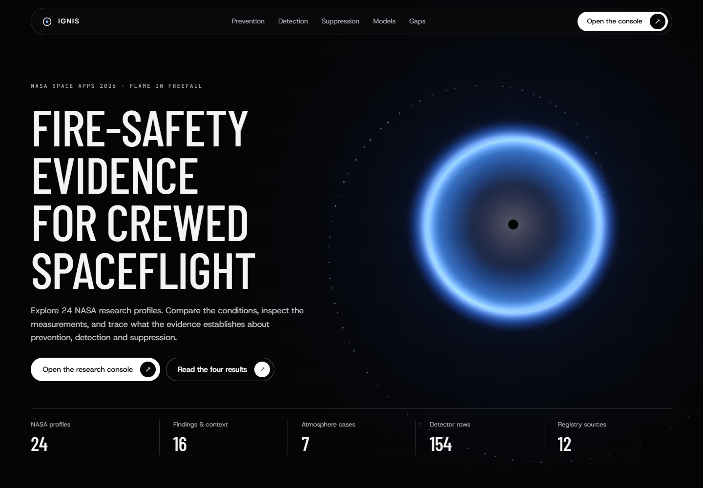
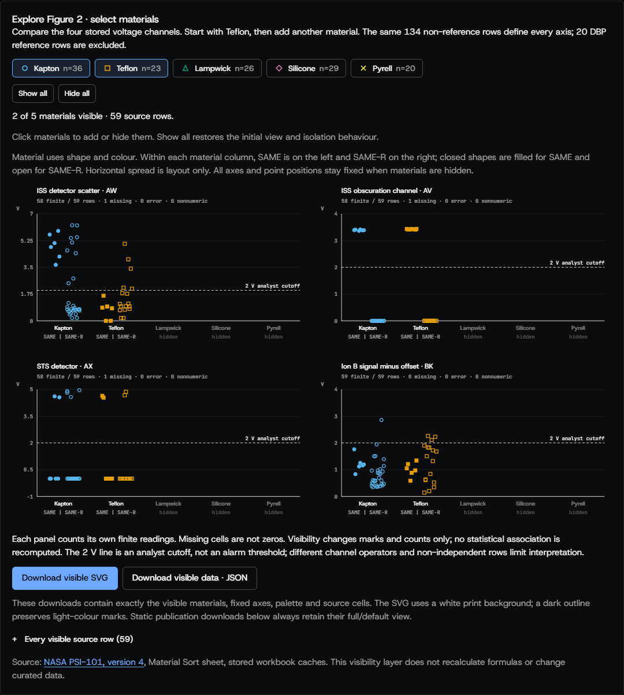
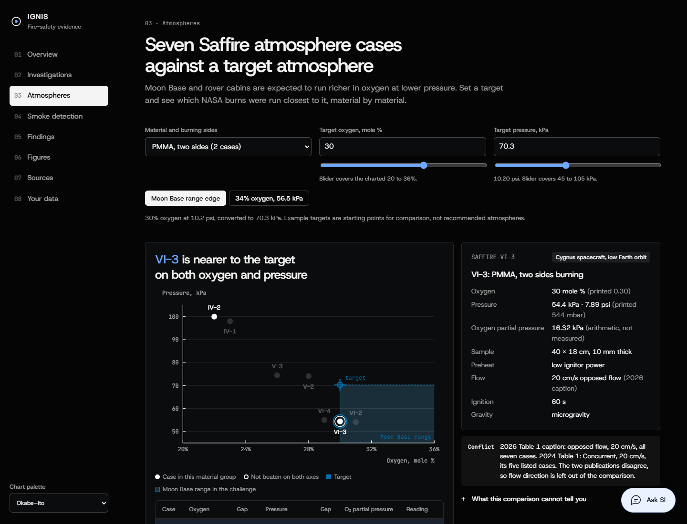
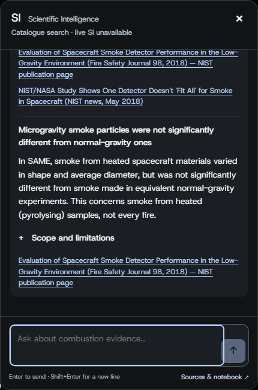
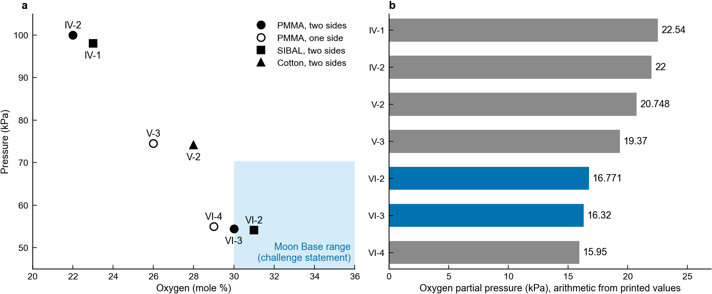

# IGNIS

**Fire-safety evidence for spacecraft and lunar habitats.**

IGNIS brings NASA combustion research, experimental measurements and reproducible analysis into one browser workspace. Researchers can compare published conditions, inspect detector readings, follow source evidence and explore their own data.

Developed by **team Emberfall** for **NASA Space Apps Challenge 2026 - Flame in Freefall**.

[Run locally](#run-locally) · [Research workflows](#research-workflows) · [Figures and code](#figures-and-code) · [Project record](PROJECT_RECORD.md)



## Research workflows

| Workspace | What it provides |
| --- | --- |
| Investigations | Search 24 NASA PSI profiles, inspect their objectives and compare available evidence. |
| Atmospheres | Compare seven published Saffire cases by material, burning sides, oxygen fraction and pressure. |
| Smoke detection | Inspect 154 stored detector rows; compare channels, flights and materials; explore cutoff sensitivity and rank association. |
| Findings | Trace findings to sources and check whether a published model supports the requested quantity and claim. |
| Figures | Isolate or combine materials, switch palettes, and download the exact visible data and SVG. |
| Your data | Import a CSV locally, declare units and measurement context, and reproduce the analysis from its exported record. |
| Sources | Inspect provenance, check citation identity, and export or recompute research notebooks. |
| SI chat | Find reviewed evidence from the floating Scientific Intelligence panel. Catalogue search works without an API key; live model interpretation remains disabled pending acceptance. |

The 24 profiles describe the searchable inventory. The assessment registry separately contains 10 investigations and 16 findings/context records; these counts do not represent independent experiments.



*Select one material, then add another for comparison. Axes stay fixed; missing values and original source cells remain visible. The plotted cutoffs are analyst choices, not alarm thresholds.*

<details>
<summary>View the research console and SI panel</summary>





</details>

## Figures and code



The publication figures are available as **PDF, PNG and SVG**, with **Okabe-Ito** and monochrome palettes. The reproduction bundle contains Python code, the derived figure inputs and dependency pins.

- [Browse publication figures](web/public/figures/)
- [Download the reproduction bundle](web/public/figures/code/ignis-figure-reproduction.zip)
- [Figure code and instructions](web/public/figures/code/README.txt)
- [Statistical method and interpretation limits](web/docs/DETECTOR_ASSOCIATION_METHOD_2026-11-15.md)

The atmosphere chart displays published coordinates. It does not predict burning behaviour or establish a safe atmosphere.

## Run locally

Use **Node.js 22.13 or newer within the 22.x family**, with npm.

```sh
git clone https://github.com/GA5413L/IGNIS.git
cd IGNIS/web
npm ci --include=dev
npm run build
npm start
```

Open **http://localhost:3000**. For development, use `npm run dev`. The start command respects `PORT`; build and development retain the project's webpack configuration.

### Render settings

| Setting | Value |
| --- | --- |
| Runtime | Node.js 22.x |
| Root directory | `web` |
| Build command | `npm ci --include=dev && npm run build` |
| Start command | `npm start` |
| Pre-deploy command | Empty |

The research workflows and catalogue chat need no API key. Keep `AI_ENABLED=false` and `CF_SI_ENABLED=false` for the current release. See [deployment instructions](web/docs/HOSTING_HANDOFF_2026-11-15.md).

## Reproduce and verify

From `web/`:

```sh
npm run validate:data
npm run test:team
npm run lint
npm run build
npm run typecheck
```

The [application guide](web/README.md) covers analysis exports and command-line replay. [Contributing](CONTRIBUTING.md) describes browser checks and scientific conventions. [Verification status](web/docs/BUILD_STATUS.md) separates historical execution results from this documentation cleanup.

## Repository guide

| Path | Contents |
| --- | --- |
| `web/src/` | Next.js interface, scientific calculations and server APIs |
| `web/data/` | Curated records, source identities and model-applicability contracts |
| `web/tests/` | Unit, integration, export and browser checks |
| `web/scripts/` | Curation, analysis, verification and figure-generation commands |
| `web/public/figures/` | Existing publication figures and reproduction code |
| `web/docs/` | Data provenance, scientific methods, deployment and disclosure |
| `research/`, `manifests/`, `tools/` | Supporting source research, attribution, verification and acquisition utilities |
| `media/` | Screenshots for this README |

## Sources and project record

NASA PSI and NTRS records, NIST publications and cited combustion literature supply the evidence. Source versions, units, missingness and experimental context are retained. Read the [data provenance](web/docs/ATLAS_DATA_PROVENANCE.md), [detector provenance](web/docs/DETECTOR_DATA_PROVENANCE.md) and [source-rights record](web/docs/SOURCE_RIGHTS.md).

Pre-event research and AI assistance are disclosed in the [project record](PROJECT_RECORD.md) and [AI-use statement](web/docs/AI_DISCLOSURE.md). The 16 November repository cleanup changes documentation and README images only; application code, data, tests, public assets, configuration and dependencies are preserved. Screenshots were captured after submission from that unchanged application.

IGNIS is an independent research prototype by team Emberfall, without NASA affiliation or endorsement. It presents evidence and descriptive analyses; it does not certify fire safety or provide a validated physical predictor.
