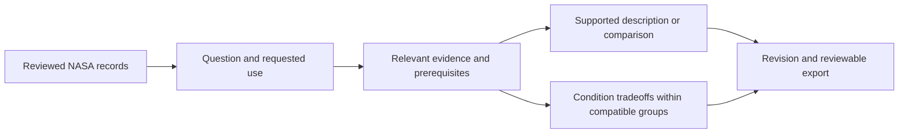

# IGNIS: research decision and competitive build handoff

**15 November 2026, PKT — research continuation completed with explicit remaining gaps.**

**Recommendation:** make IGNIS a research workbench that turns NASA findings into a defensible comparison, shows what changes when an assumption changes, and exports the evidence and reasoning needed to review it. Its strongest candidate contribution is the connection between experimental conditions, measurement meaning, model-data reuse and revision. A finite Pareto view can explain condition tradeoffs inside that workflow. Neither the view nor the present prototype establishes predictive SOTA or superiority to all competitors.

This decision follows the existing master specification and its amendments. It narrows the event build instead of replacing the architecture. The registered team remains Emberfall; IGNIS is the working product name pending the user's naming decision. There is one active human builder. The deadline recorded from the supplied Universal Event guide and confirmed owner time zone is **15 November, 23:59 PKT**; the existing feature freeze is **18:00 PKT**.

## 1. What this continuation completed

The user requested a lab-style review of competitors, current research, the existing implementation and all consequential scientific fields. Three AI specialist agents worked alongside the lead assistant. Their specialties and deliverables were:

| Responsibility | Completed output | Standard applied |
|---|---|---|
| Combustion, materials, atmosphere and gravity | [Physics completion](lab/04_physics_completion_2026-11-15.md) | Separate actual test tuples from campaign ranges; distinguish platform, fuel, geometry, history and endpoint. |
| Aerosols, detection, suppression and aftermath | [Detection completion](lab/05_detection_completion_2026-11-15.md) | Inspect original tables/workbook cells, measurement operators, thresholds, clocks and missingness. |
| Mathematical modelling, transfer, uncertainty and evaluation | [Models and mathematics completion](lab/06_models_math_completion_2026-11-15.md) | Separate verification, calibration, intended-use validation, finite mathematical guarantees and performance claims. |
| Research direction, competitors and delivery | [Competitive update](COMPETITIVE_UPDATE_2026-11-15.md), this synthesis and [build order](WIN_PLAN.md) | Check public claims against pinned source; choose a feasible contribution and an honest comparison. |

These are AI-assisted specialist reviews, **not independent human scientific validation**. No named scientist, institution or prospective user has reviewed or adopted IGNIS. The earlier three lab notes remain historical background; the completion notes record corrections, access limits and exact source locators.

The work includes a bounded refresh of ten public repositories, nine selected implementation/method files, new primary-source inspection, a primary SAME/SAME-R workbook audit, and finite mathematical checks. Search coverage is documented rather than called exhaustive. Some recent papers remain abstract-only. No paid inference, simulator execution, competitor execution, deployment, publication or external communication occurred in this continuation.

## 2. Competitive judgment

The strongest public projects already provide good exploration, source links, condition matching, uncertainty language, data exports and polished narratives. MARGIN already includes the Saffire VI example; HALO now explicitly distinguishes Saffire literature from PSI tables. PYRION documents deterministic verdicts with an interpreting language model. Those features cannot be advertised as unique to IGNIS. See the [pinned comparison and its limits](COMPETITIVE_UPDATE_2026-11-15.md).

IGNIS currently has useful deterministic model-comparison contracts, revisions and consistent exports. It is behind several documented competitors in visible breadth, integrated primary tables and presentation readiness. A comparison of their README scores with our different test sets would be meaningless. We have not run their systems or measured which product users prefer.

The competition asks for an interactive dashboard that summarizes, ranks and interprets combustion findings. The supplied judging guide considers Impact, Creativity, Validity, Relevance and Presentation. A reproducible workflow can be a meaningful improvement without claiming a new law of fire physics. The challenge explicitly includes prevention, detection and suppression, so the product must remain useful without selecting a mathematical model. [Official challenge](https://www.spaceappschallenge.org/2026/challenges/flame-in-freefall/); [provided judging guide](../../DOCS/NASA%20Space%20Apps%20Challenge2.pdf).

**Positioning to test:** “IGNIS helps researchers see what a NASA result supports for their question, what an extrapolation would require, and why a changed assumption changes the conclusion.” The test is whether users reach more correct, useful, reviewable answers than with an equally informed spreadsheet—not whether our interface displays more warnings.

## 3. Scientific conclusions that change the solution

### Actual experimental conditions outrank broad coverage slogans

Published solid-fire research extends beyond the acquired PSI experimental tables. Saffire VI includes distinct enriched-oxygen, reduced-pressure SIBAL and PMMA configurations. A 2026 RTDFS paper reports ISS acrylic-sheet work at 30% oxygen and 0.5/1 atm. These are relevant observations, not lunar-surface validation. The later GEL campaign spans broad pressure/oxygen ranges, but the published extinction map inspected here is specifically at one atmosphere. A range in each column does not establish every possible joint condition. [Physics report, sources S1–S7](lab/04_physics_completion_2026-11-15.md#6-primary-source-access-and-exact-locators).

**Build consequence:** every condition record must distinguish a tested tuple, an evolving history, a marginal campaign range and an unknown. Show material, geometry, platform and observable alongside atmosphere values. Make the corpus restriction visible when answering a PSI-only question. Do not silently supply pressure or turn oxygen partial pressure into a flammability-equivalence score.

### The detector data supports useful answers, with precise limits

The original PSI-101 analyzed-results workbook contains real detector channels absent from the smaller experimental CSV. A source-only recount reproduces 20/35 finite Kapton scatter readings and 18/23 Teflon readings below an analyst-selected 2.0 V cutoff. Those are valid descriptive counts under that selection, not demonstrated alarm misses. The workbook has calibration and processing fields, spreadsheet error cells, reference-particle rows and multiple analysis sheets; a generic numeric importer would erase important distinctions.

The SAME-R CSV and workbook both contain 109 campaign rows but differ in a material/test key on each side. The detection report provides the file hashes and row/cell locators. Equal row counts do not establish successful reconciliation. Preserve both source versions and their identities; do not delete or invent a record to make them agree. [PSI-101 public record](https://psi.nasa.gov/geode-py/ws/repo/investigations/PSI-101); [audit and limitations](lab/05_detection_completion_2026-11-15.md).

**Build consequence:** offer a channel-response comparison with its actual denominator and selectable, clearly named analyst cutoff. Require a documented detector transfer function and alarm algorithm for an alarm-outcome claim. Keep smoke aging, instrument response and transport-to-sensor as separate causes. This provides positive detection functionality while preventing a specific overinterpretation.

### Matching units is not enough to match measurements

The Saffire sources use distinct aerosol reference levels and experiment clocks. The 2026 table's VI-3 and VI-4 alarm-reference entries are 1,037 s and 1,603 s at 2 mg/m³; associated gas values are **increases**, not absolute cabin concentrations or exposure averages. The earlier 981 s statement uses a different reference level. The 2026 table also calls the sample flow opposed, while the 2024 source describes concurrent flow. Preserve those source-specific statements as an unresolved conflict instead of choosing one silently. [Detection report, Saffire audit](lab/05_detection_completion_2026-11-15.md).

**Build consequence:** a comparison needs quantity, units/basis, measurement operator, location, threshold, time origin and window when those affect the requested operation. A missing alarm clock blocks an ignition-to-alarm subtraction; it does not block reading the source's reported time. Do not derive health or crew-action recommendations from isolated increments.

### A fitted or supplied quantity can still support a useful conditional analysis

The existing Saffire contracts correctly distinguish a source-driven cabin transport calculation from independent prediction of the burning source. Initial alignment or supplied total mass changes what agreement can establish. It does not make all later-response comparison worthless. Preserve the A-001 conditional route, T1–T4 logic and repaired AC04 treatment of known fitting versus missing transformation details. The 497 kJ sensible-heat value and 1,280 kJ calorimetric value also involve different measurement operators; their ratio is not model accuracy.

**Build consequence:** show which target information entered the model and which later quantity remains available for a specified comparison. Retain positive descriptive calculations already implemented. Published scaling or CFD is a candidate only for a defined use and documented domain; a successful run or broad validation claim does not establish the present use. [Master amendments](../../DOCS/IGNIS_MASTER_AMENDMENTS.md); [models review](lab/06_models_math_completion_2026-11-15.md).

### The remaining physics is task-dependent

The master already contains a 120-entry variable dictionary. It is a conditional curation dictionary, not 120 mandatory user inputs or independent causal variables. The review connects its fields to the operations they actually affect:

| Field of research | Variables or distinctions that can change the answer | Product treatment |
|---|---|---|
| Atmosphere and thermodynamics | Ambient versus burner-stream composition; absolute pressure; oxygen basis; diluents; humidity; gas temperature; evolving composition | Preserve actual simultaneous measurements; compute partial pressure only with its prerequisites. |
| Gravity and fluid mechanics | Acceleration vector/history, platform and duration; forced/buoyant flow; direction; reference velocity and local profile | Distinguish orbital, drop-tower, aircraft and centrifuge evidence. Lunar and Mars surface gravity require a relevant transfer route. |
| Heat transfer and radiation | Conduction, preheat, thermal thickness, emissivity spectrum, view factors, heat loss | Require the variables consumed by a calculation; avoid a universal geometry or reflectivity multiplier. |
| Materials and solid chemistry | Grade, additives, char/melt behavior, exposed faces, thickness, backing, specimen/burn history | Retain source identities and sequence; a generic polymer name is insufficient for material transfer. |
| Gas chemistry and kinetics | Mechanism version, fuel, rate/transport data, finite reaction times, cool-flame behavior | Separate hot-flame disappearance, residual reaction, complete extinction and reignition endpoints. |
| Confinement and apparatus | Baffles, duct dimensions, bypass, enclosure volume, walls, fan calibration | Treat apparatus and measurement location as part of the experiment. |
| Aerosol science and detection | Size-distribution moments, morphology, aging, dilution, line losses, calibration and algorithm | Compare like channels/operators; distinguish particles, voltage, inferred concentration and alarm. |
| Suppression and recovery | Agent identity, concentration/delivery, droplet distribution, geometry, fuel and endpoint; cleanup histories | Support source-specific suppression findings. Do not recommend a universal agent dose or assume visible extinction ends the hazard. |
| Metrology and statistics | Uncertainty, baseline/tare, transformations, clocks, censoring, missingness and shared calibration | Unknown uncertainty is not zero; rows, papers and repeated burns are not automatically independent evidence. |
| Mathematics and simulation | Dimensionless-group definitions, property/length scales, joint domain, solver verification, calibration and model discrepancy | Offer an explicit comparison plan or an applicable published method; do not fabricate missing inputs. |
| Human use and research software | Traceable claims, correction history, understandable limits, reproducible exports | Optimize correct useful completion and review effort, rather than a decorative confidence percentage. |
| Quantum physics | Upstream electronic-structure/rate calculations and spectroscopy; distinct from quantum computing | Relevant to a narrowly justified chemistry model. No quantum module is justified by this task's data or bottleneck. |

The physics review found real quantum-chemistry work on MMA kinetics, while the inspected quantum-computing study concerns emulated small combustion systems. Neither supplies a demonstrated advantage for this dashboard. Likewise, the acquired 2026 centrifuge model studies a prescribed-fuel heptane wick with simplifying chemistry/radiation assumptions; it is not a universal solid-fuel lunar extinction correction. The sources and access limits are in the specialist notes. Rockets/propellants remain outside the challenge's principal habitable-environment scope.

## 4. The selected solution

Keep the existing connected **Explore → Analysis → revision → export** workflow. The default view provides prevention, detection and suppression findings. A model is optional. The core user benefit is a short supported conclusion with a visible way to inspect the necessary evidence and assumptions.

Use the current typed registry and deterministic engine. Extend records only where new evidence needs a distinct condition tuple, measurement definition or relationship. Do not replace the repository with a graph database, a large agent platform or a new simulator during the event.

The result should show, in this order:

1. **Useful answer:** the finding or specified comparison the evidence supports, including relevant positive results.
2. **Evidence:** original source, version, page/table/cell and original units; review level visible.
3. **Applicability:** the premises needed for the selected use, with satisfied/unknown/contradicted kept distinct.
4. **Tradeoffs:** documented condition gaps where a numeric comparison makes sense; other relevant findings remain discoverable.
5. **Next step:** the particular missing datum, reconciliation or published method that would change the answer.
6. **Revision/export:** changed assumptions, affected conclusion and immutable assessment content in the existing export formats.

Language-model assistance remains interpretation-only: propose catalogue-bound intent/IDs, allow user confirmation, and let deterministic checks produce scientific outcomes. It must not invent evidence, grades, physical predictions or verdict fields. Evaluation authorization is already recorded in D-051/D-054; no provider currently has a passing, accepted event configuration. Preserve the frozen study and budget rules. Credential rejection is not a scientific or model-quality result.

### Three demonstration stories

| Story | Positive result to demonstrate | Scientific boundary that must be visible |
|---|---|---|
| **Prevention: find actual relevant burns** | Compare reviewed enriched-oxygen solid-fire records with material, pressure, platform and endpoint; open the original source. | Actual joint cases versus marginal ranges; orbital versus lunar gravity; different material geometries and histories. |
| **Detection: inspect a response and its denominator** | Show original SAME/SAME-R channel measurements and a reproducible descriptive count. | Analyst cutoff versus documented alarm; excluded/missing cells; unresolved CSV/workbook identity mismatch. |
| **Analysis: revise what the model is asked to establish** | Start with the existing conditional later-response comparison, then change to independent source/heat prediction and show the changed outcome and export. | Supplied/fitted information, operator mismatch and retained useful conditional comparison. |

Suppression must still have a genuine, source-supported path in the broad brief: FLEX/CFI distinguish fuel, diluent and hot/cool-flame endpoints, with water-mist/cleanup findings shown at their reported scale. Do not spend the event building an unvalidated extinguisher optimizer. BASS-II thermal/history evidence remains a valuable optional second prevention case once its existing quarantines and conditional records are preserved.

## 5. Exactly what the Pareto contribution means

There are three different claims:

| Claim | Present status | What would establish it |
|---|---|---|
| **Finite condition-gap frontier** | Core module exists, is not wired into the UI, and needs input/test corrections. | Freeze the eligible records, target, gap definitions and missingness groups; reproduce the nondominated set and a dominating witness for every excluded point. |
| **Product-performance Pareto improvement** | **NOT RUN.** | Matched tasks and information; measured error, useful completion, time, effort and cost; explicit uncertainty and tradeoffs. |
| **Predictive fire-science SOTA** | **NOT ESTABLISHED.** | A defined prediction task, current strong models, suitable data/domain, leakage-controlled validation and independent review. The present project does not supply these. |

For a finite eligible set with fixed gap coordinates, retain every point that no other point matches or improves on all coordinates while improving on at least one. This is a standard mathematical operation, not a newly discovered theorem. It preserves an optimum for coordinatewise monotone preferences over those defined gaps. It does not show which material is safer or which physical experiment is most informative.

Before computing it, apply question-specific evidence eligibility. Keep different documented-axis signatures separate. Otherwise missing data can appear advantageous, and comparing pairwise intersections can even produce a cycle. Show excluded evidence, unknown-axis records and ties explicitly. Choices of axes, distances, signed-versus-absolute treatment and measurement uncertainty remain substantive choices even without weights. Positive unit rescaling of defined gaps is different from changing the physical distance definition.

Two concrete issues require correction before integration:

- A non-finite target (`NaN`/`Infinity`) can produce invalid gaps in the current module; reject it at the boundary.
- The test's fixed `1e-9` scalarizer argument is not universal. Both `(1,1)` and `(1.0000000001,0)` are nondominated, yet the purported scalarizer for the first prefers the second. This is a defect in that test construction, not a disproof of finite Pareto filtering.

The mathematics specialist saved exact-rational and JavaScript counterexamples, checked **766 synthetic finite subsets** and **1,058 adaptive scalarizer cases**, and documented ties/missingness. These are bounded mathematical checks, **not 766 physical validations or a competitor benchmark**. No application source was changed in this research continuation. [Proof, checks and limits](lab/06_models_math_completion_2026-11-15.md).

## 6. Evaluation that could justify the claim

The existing D-024 hypothesis remains appropriate: reduce incorrectly admitted evidence in multi-record answers compared with a curated spreadsheet containing **identical information**. Also measure useful positive/conditional completion, so an engine that refuses everything cannot win the comparison.

| Comparison | Controls | Measurements |
|---|---|---|
| Curated spreadsheet versus IGNIS | Same records, citations, crosswalks and conflict information; counterbalanced task order | Consequential interpretation errors, correct supported completions, source checks and elapsed time. |
| Fixed-weight ranking versus finite frontier | Same eligible records/axes/missingness and presentation budget | Useful evidence retained, chosen-record changes under preferences, omissions and user effort. A larger frontier can increase workload. |
| Contract checks versus documented ablation | Same task and evidence; remove one safeguard at a time only in an offline evaluation | Whether the specific guard prevents its targeted error and whether useful answers are lost. |
| Typed input versus an accepted interpreter | Same deterministic engine and task intent | Semantic errors, clarification behavior, schema failures, latency and consumption under the existing frozen IE-1 protocol. |

The following are **new, visible development cases**, not sealed held-out questions and not a replacement for IE-1 or the earlier frozen studies:

| Case | Required useful result | Failure to catch |
|---|---|---|
| RC01: source subset | Return relevant published solid cases; scope a PSI-only answer explicitly. | Turn catalog absence into absence of all NASA research. |
| RC02: joint condition | Distinguish actual tuples from separate campaign ranges. | Fabricate a 34%/reduced-pressure GEL run from marginal ranges. |
| RC03: detector response | Reproduce the primary-channel count and denominator. | Call a 2 V cutoff an observed alarm failure without the calibration/algorithm. |
| RC04: identity reconciliation | Preserve both 109-row sources and list unmatched keys. | Declare equivalence from equal totals or silently drop a record. |
| RC05: time and operator | Display source-reported thresholds, clocks and increments. | Subtract unlike alarm times or turn increments into exposures. |
| RC06: conditional model | Retain a useful later-response comparison; revise its claim when target use changes. | Treat calibration as independent validation or reject all conditional use. |
| RC07: frontier | Retain ties and separate missingness groups; reject invalid targets. | Use absent coordinates as zero gaps or claim global physical optimality. |
| RC08: positive transfer | Admit an explicitly in-domain published method when all consumed prerequisites are satisfied. | Blanket-reject every cross-environment use, or invent missing properties to execute it. |

Report denominators separately: task-level completion, claims admitted, consequential errors, schema errors and abstentions. Group shared campaigns/specimens when splitting research examples. Source citations must support the claim, not merely match a sentence. Do not count repeated papers as replication or report a small zero-error sample as proof of zero risk.

The existing human-authored held-out-task requirement is preserved: an assistant-authored test or another AI specialist's review does not satisfy it. If no human reviewer is available by the event deadline, label the work development evidence and assistant-checked. Useful software can still be demonstrated, but independent validation, user-study success and general superiority remain **NOT RUN**. The [models report](lab/06_models_math_completion_2026-11-15.md) sets out stronger post-event validation and relevant scientific-assistant research.

## 7. A credible path to adoption

The reusable unit should be a small reviewed evidence/assessment package, not a dependency on our website. Give it stable identifiers, original source locators, units/operators, source hashes, relationships, transformation history, explicit review status, schema version, examples and a documented correction process. Existing JSON and Markdown exports are a useful starting point. A downstream researcher should be able to inspect the evidence and repeat the deterministic assessment offline.

FAIR principles emphasize identifiers, rich metadata, provenance and explicit reuse terms; W3C PROV provides a vocabulary for entities, activities and derivations. They are useful design references, not a badge of certified compliance. An optional RO-Crate packaging pass belongs after the event, once artifacts and licenses are stable. [FAIR original paper](https://doi.org/10.1038/sdata.2016.18); [W3C PROV overview](https://www.w3.org/TR/prov-overview/); [RO-Crate specification](https://www.researchobject.org/ro-crate/specification).

The local PSI metadata audit found **23 records declaring CC0-1.0 and blank license fields for PSI-10**. Keep per-item rights; do not describe the entire corpus as uniformly CC0. Publisher PDFs and the raw acquisition cache are research inputs, not public-site assets. Public exports need an explicit source/rights review, especially before adding downloadable datasets.

**Post-event targets, not achievements:** obtain one qualified review of each demonstrated scientific operation; let a researcher reproduce an assessment from the exported package; evaluate unseen, human-authored tasks; and have an external contributor add one investigation without changing core logic. Record corrections and failures. A researcher actually reusing the package, or submitting a reviewed extension, is adoption evidence; a repository star or our own assertion is not. No outreach or publishing is authorized or performed by this plan.

## 8. Existing implementation and remaining work

| Item | Observed status |
|---|---|
| Registry and application checks | The preceding local review passed **81/81 unit/integration tests** and catalogue validation. These are software checks; provider transport is mocked. |
| Production build/browser checks | Earlier handoff reports a passing build and 7 browser tests with 1 skipped. **Not rerun in this research continuation.** |
| Current registry | 10 investigations, including 3 profiles; 16 findings; 12 sources; 26 assistant-checked assertions. |
| Primary data | 24 PSI records and 22 CSVs acquired; 47 saved record/CSV hashes checked in the preceding review. The new PSI-101 workbook is additionally acquired and audited. These are not all curated in the app. |
| Interpretation | Adapters and a frozen evaluation runner exist. No event configuration has a successful semantic evaluation/acceptance; app runtime remains disabled. |
| Frontier | Core and tests exist; UI integration absent; corrections described above are pending. |
| Release/presentation | Public deployment, signed-out production verification, final deck and submission remain unfinished. Hosting is waiting under D-053. |

The [updated build order](WIN_PLAN.md) defines a bounded sequence for one active builder, with cuts and acceptance evidence. The most valuable next implementation is to expose the newly audited evidence in the existing workflow, repair and integrate the bounded frontier only where its prerequisites hold, and demonstrate a visible revision with a reliable export. Keep time for usability and presentation.

Preparation reuse is already the user's decision under D-050. Live testing is already bounded by D-051/D-054. Neither needs to be reopened for this research. A GoDaddy domain does not specify the hosting runtime; the earlier inference that it requires a static rewrite is not a user requirement. Deployment remains on hold, and the product name remains a separate user choice.

## 9. Claim register and stopping rule

**Supported now:** a running local deterministic prototype; assistant-checked source findings; public repository inspection at stated commits; the primary workbook recount and reconciliation discrepancy; bounded mathematical diagnostics; a concrete build and evaluation plan.

**Still unexecuted or unestablished:** application integration of the new research; current live-model evaluation; competitor runtime comparison; independent human validation; user-study improvement; transfer-model replay; global/SOTA predictive performance; public deployment; adoption or winning the competition.

This research pass ends with those boundaries. Additional searches should be triggered by a consequential unresolved claim needed for the chosen demonstration—not by a desire to collect every adjacent paper. Complete the three useful stories, source traces, revision behavior and presentation before adding new scientific modules. At 18:00 PKT, stop new features and use the remaining time for verification, the final submission package and any separately authorized release.
